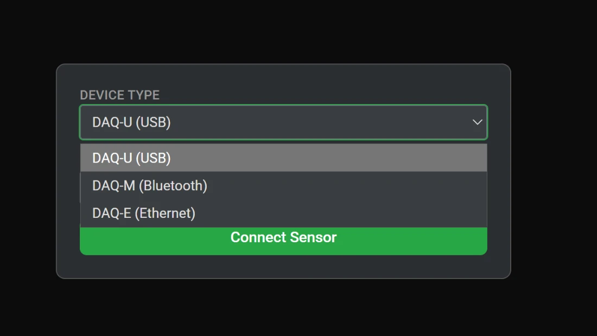

# O separador DAQ no Chloros

O separador DAQ — intitulado **Sensores de luz** na barra lateral do Chloros — é a interface de controlo em tempo real para os [sensores de luz DAQ-U, DAQ-M e DAQ-E](README.md): ligue sensores através de qualquer protocolo de transporte, visualize espectros calibrados em tempo real, calcule a refletância em tempo real a partir de um par de sensores e registe ficheiros `.daq` diretamente no seu projeto.

A separador fica disponível assim que o backend do Chloros terminar de iniciar. Os gráficos da separador são alimentados pelo serviço DAQ do Chloros através de uma ligação em tempo real que se restabelece automaticamente (tempo de espera de 2 a 10 s) caso seja interrompida; enquanto o serviço estiver inacessível, a linha de estado de um sensor exibe **Sem servidor**.

O layout consiste numa **barra lateral de sensores**(uma linha por sensor ligado) e numa**área de gráficos** (um bloco de gráfico por sensor ou grupo).

<!-- SCREENSHOT-NEEDED: full DAQ (Light Sensors) tab in list view with one DAQ-E connected — sensor sidebar on the left (Connect Sensor + Record All buttons, one sensor row), spectrum chart with rainbow fill in the main area, live data table below the chart -->

***

## Ligar um sensor

Clique em **Ligar Sensor**na parte superior da barra lateral. A caixa de diálogo de ligação abre-se na área principal (ou como uma sobreposição ao adicionar outro sensor — nesse caso, aparece um botão**Cancelar**).

| Controlo | Comportamento |
| --- | --- |
| **Tipo de dispositivo** | `DAQ-U (USB)` (padrão), `DAQ-M (Bluetooth)` ou `DAQ-E (Ethernet)`. Ao alternar, a procura pelo transporte recém-selecionado é reiniciada. |
| **Porta / Dispositivo BLE / Nome do anfitrião / IP** | Lista os dispositivos detetados como `device - description`; a primeira entrada reconhecida como sensor é selecionada automaticamente. Durante a pesquisa, apresenta `Scanning...` (USB), `Scanning (N)...` com uma contagem decrescente de 8 segundos (BLE) ou `Discovering ethernet sensors (N)...` com uma contagem decrescente de 5 segundos (Ethernet). Os resultados vazios são apresentados como `No ports` / `No BLE devices` / `No ethernet sensors found`. |
| **↻ Atualizar** | Volta a analisar o transporte selecionado imediatamente (desativado durante a análise BLE/Ethernet). |
| **Ligar Sensor** | Ativado assim que um dispositivo é selecionado; renomeia para `Connecting...` enquanto a ligação é estabelecida. |

A deteção só é executada **enquanto a caixa de diálogo de ligação estiver no ecrã** e repete-se a cada 15 segundos apenas para o transporte selecionado — a simples abertura do separador não inicia a deteção. Em caso de falha, a caixa de diálogo apresenta: *«Falha na ligação. Tente desligar e voltar a ligar o sensor e, em seguida, clique novamente em "Ligar".»*

A barra lateral abre-se automaticamente quando o seu primeiro sensor se liga.


**O DAQ-E não aparece?**O DAQ-E não tem LED de estado — verifique o indicador PoE/ligação no switch ou na porta do injetor em que está ligado e aguarde alguns segundos após a ligação para que inicie. A máquina Chloros deve estar no mesmo domínio de difusão (o mDNS não atravessa routers). A regra de firewall**Backend do Chloros (UDP-In)** do instalador permite a passagem de mDNS (UDP 5353), dados do DAQ-E (UDP 5002) e PTP (UDP 319/320); um firewall de terceiros necessita de ter as mesmas portas permitidas. Duas unidades DAQ-E numa mesma LAN são detetadas separadamente, cada uma com o seu próprio nome de anfitrião `daq-e-<id>.local`.


<figure><figcaption>O «Tipo de dispositivo» oferece DAQ-U (USB), DAQ-M (Bluetooth) e DAQ-E (Ethernet)</figcaption></figure>

***

## A barra lateral dos sensores

Cada sensor ligado recebe uma linha (mais uma linha por grupo «Ambiente+Objeto»). As linhas podem ser reordenadas por arrastar, e a sua ordem também reordena os blocos do gráfico. Clique numa linha para tornar esse sensor/grupo no gráfico ativo na vista de lista.

| Elemento | Significado |
| --- | --- |
| Borda esquerda colorida | A cor do gráfico do sensor. |
| Emblema de transporte | `DAQ-U` / `DAQ-M` / `DAQ-E`, ou um emblema verde `REF` para um grupo de refletância «Ambient+Object». |
| Nome do dispositivo | Por predefinição, é o número de série do sensor (a sua identidade estável para calibração, nomes de ficheiros `.daq` e correspondência de importação); os nomes personalizados mantêm-se por projeto. |
| Botão **Calibrado** (verde) | Exibido quando o pacote de calibração de fábrica do sensor é carregado, ou seja, os espectros estão expressos em W/m²/nm. |
| Indicador **Atualização disponível** (âmbar, apenas DAQ-E) | O firmware em execução é mais antigo do que a imagem incluída nesta compilação do Chloros. Durante uma atualização, mostra o progresso em tempo real (`Flashing… N%`, `Restarting sensor…`, depois `Updated X → Y` ou `Failed`). |
| Olho | Alterna a visibilidade deste sensor no seu gráfico. |
| Engrenagem | Abre a janela modal de configurações específicas do sensor (abaixo). |
| ✕ (vermelho) | Desliga o sensor ou remove um grupo «Ambiente+Objeto». |

Acima das linhas encontram-se dois botões:

* **Ligar Sensor** — abre a caixa de diálogo de ligação (renomeia-se para `Connecting...` enquanto está ocupado).
* **Gravar tudo / Parar tudo**— inicia ou interrompe uma gravação `.daq` em**todos**os sensores ligados. Requer pelo menos um sensor**e um projeto aberto** (dica de ferramenta: «Abrir um projeto para gravar»); fica a vermelho enquanto qualquer gravação estiver a decorrer.

No estado vazio, exibe «Nenhum sensor ligado».

<!-- SCREENSHOT-NEEDED: sensor sidebar with three rows — a DAQ-E showing both the green Calibrated pill and the amber Update Available pill, a DAQ-U row, and a green REF group row — plus the Connect Sensor and Record All buttons -->

***

## Definições por sensor (a janela modal da roda dentada)

Abre-se com o ícone da roda dentada numa linha de sensor. Conteúdo por ordem:

* **Linhas de informação** — Tipo de dispositivo (DAQ-U/M/E), Ligação (`Serial (USB)` / `Bluetooth` / `Ethernet`), Porta (porta COM, endereço BLE ou anfitrião) e Serial.
* **Relatório de calibração: Descarregar** — obtém o certificado de calibração rastreável pelo NIST (PDF) desta unidade e abre-o no seu visualizador de PDF. Disponível assim que o número de série for conhecido; o certificado é armazenado em cache na primeira ligação.
* **Nome do dispositivo** — clique no lápis para renomear; mantém-se por projeto.
* **Cor da linha do gráfico** — amostra de cor; mantém-se por projeto.
* **Tempo de integração (ms)**— barra deslizante + número,**1–500 ms**, predefinição**32 ms**. Desativado enquanto a AE estiver ativada.
* **Média de fotogramas**— barra deslizante + número,**1–50 fotogramas**, predefinição**20**.
* **AE: LIGADO/DESLIGADO**— botão de alternância da exposição automática;**padrão LIGADO** na ligação. Desligue-o para definir manualmente o tempo de integração.
* **Parar transmissão / Iniciar transmissão** — pausa ou retoma da transmissão ao vivo.
* **Gravar / Parar Gravação** — gravação `.daq` por sensor (requer um projeto aberto).
* **Cap** — o perfil de correção de cap (próxima secção).
* **Linhas de informação em tempo real** — Tempo de integração (ms), FPS, Amostras, Gravação (`REC` ou `Off` a vermelho) e Estado (`Streaming` / `Paused` / `SATURATED` / `No Server`).

### Apenas DAQ-E: linhas de rede, firmware e PTP

* **Nome do anfitrião / IP** — o endereço atual da unidade.
* **Firmware** — versão atual do firmware, além de uma célula de ação: um<version\>

botão</version\>

**Atualizar para \<version\>** aparece quando esta compilação do Chloros inclui uma imagem de firmware mais recente para o DAQ-E. A atualização é transferida pela rede em cerca de 30 segundos; o sensor reinicia e volta a ligar-se automaticamente, e uma transferência interrompida mantém o firmware atual intacto. O progresso é transmitido em tempo real (`Flashing… N%` → `Restarting sensor…` → `Updated X → Y`), e a célula indica `Up to date` quando atualizada.
* **Sincronização PTP** — o estado PTP em tempo real (reverte para `unknown`). O firmware DAQ-E v1.2.0+ participa no PTPv2 da norma IEEE 1588 como um relógio exclusivamente escravo; o backend do host Chloros é o «grandmaster» PTP, e todas as câmaras DAQ-E e LATTICE na LAN funcionam como escravas no domínio 0, mantendo os carimbos de data/hora com uma precisão de aproximadamente 1 ms.
* **Rede**— o endereço em que a unidade funciona e como o obteve (DHCP, link-local ou estático), bem como uma configuração guardada que se aplica após um reinício.**Alterar…**abre um formulário:**Automático (DHCP)**ou**IP estático**com um endereço IP, uma máscara de sub-rede e um gateway opcional.**Aplicar e reiniciar** guarda a configuração, reinicia o sensor e volta a ligá-lo. Um endereço estático fora da rede deste computador é recusado, porque o Chloros não conseguiu aceder ao sensor após o reinício; surge então uma caixa de seleção para permitir essa opção na mesma, para um computador que será reendereçado ou encaminhado para essa rede. **Transmissão ao ligar**define se o sensor inicia a transmissão assim que é ligado, antes de qualquer software se ligar.**Reiniciar sensor** reinicia-o e reconecta-o com as suas definições atuais. A reinicialização é recusada enquanto o sensor estiver a registar. Novidade na versão 1.3.0.

Para um grupo «Ambient+Object», o modal da roda dentada mostra apenas os sensores de origem do grupo, o Nome do Dispositivo e a Cor da Linha do Gráfico.

<!-- SCREENSHOT-NEEDED: per-sensor settings modal for a DAQ-E — info rows, Calibration Report Download, Hostname/IP + Firmware row with an "Update to <ver>" button, PTP Sync row, Integration Time / Frame Average sliders, AE ON toggle, and the Cap dropdown all visible (scrolled composite acceptable) -->

### Seleção da tampa

O menu suspenso **Tampa** indica ao Chloros qual a tampa física que está colocada sobre o difusor do sensor e aplica o perfil de correção medido de fábrica dessa tampa a todos os espectros. As opções dependem do modelo:

| Modelo | Opções de tampa |
| --- | --- |
| DAQ-U | Nenhuma (sensor sem tampa), FOV 15°, FOV 30°, FOV 45°, FOV 60°, FOV 90°, Sunshine (corretor cosseno) |
| DAQ-M | Nenhuma (sensor descoberto), Sunshine (corretor de cosseno) |
| DAQ-E | Nenhuma (sensor descoberto), FOV 15°, FOV 45°, FOV 90°, Sunshine (corretor de cosseno) |

**A configuração predefinida para todos os modelos é «Sunshine» (corretor de cosseno)** — a MAPIR fornece todos os DAQ com a tampa «Sunshine» instalada, sendo esta a configuração padrão para utilização no exterior: uma visão hemisférica de 180° com erro de cosseno ≤ ±4 % até aos 60° e ≤ ±4,5 % até aos 70° (não recomendado abaixo de ~15° de elevação solar), com atenuação por design (~12×). A sua seleção permanece no projeto.


**A seleção da tampa deve corresponder à tampa física.**Nem o sensor nem o software conseguem detetar qual a tampa que está colocada. A seleção determina tanto a correção em tempo real como o carimbo gravado em cada ficheiro `.daq` — com a atenuação de ~12× da tampa Sunshine, uma mudança de tampa não declarada corrige incorretamente os espectros aproximadamente por esse fator. (Retirar e voltar a montar a mesma tampa repete o erro em cerca de 1,5 %.) Escolha**Nenhuma (sensor nu)** apenas quando a tampa for fisicamente removida; num DAQ-E, «Nenhum» continua a aplicar um perfil geométrico de fábrica para o seu difusor de vidro recuado — não é uma operação nula — e um DAQ-E sem difusor é uma configuração de bancada, não uma configuração de campo suportada.



Atualização a partir de um manual anterior: o botão de alternância «Sunshine Diffuser Installed» (Difusor Sunshine instalado) do lado do navegador, presente na versão 1.1.0, foi removido. O tratamento da tampa é agora feito através deste perfil de tampa por sensor, aplicado do lado do servidor.


***

## A área do gráfico

Uma barra superior fixa contém um **botão para alternar entre a vista de lista e a vista em grelha**e um controlo deslizante de**zoom do gráfico** (tamanho dos mosaicos: 200–2000 px). A vista muda automaticamente para a grelha quando existe mais do que um grupo de gráficos e volta à lista quando existe apenas um ou menos. O modo de visualização e o tamanho do gráfico são mantidos por projeto.

O **gráfico de espectro** de cada sensor mostra:

* **Eixo X** — Comprimento de onda (nm). A grelha do sensor varia entre 340–1010 nm em intervalos de 5 nm (135 pontos), interpolada para 1 nm para efeitos de visualização.
* **Eixo Y**— para um sensor calibrado (pastilha verde**Calibrado**),**Potência (W/m²/nm)**— irradiação espectral calibrada radiometricamente em todas as três unidades de medida — com um prefixo SI automático (m/µ/n) escolhido a partir do pico. Um sensor cujo pacote de calibração não esteja carregado representa as suas leituras brutas como**Intensidade (contagens)**, sem escala. Quando um gráfico sobrepõe ambos os tipos, a potência aparece no eixo da esquerda e as contagens no eixo da direita.
* Um preenchimento espectral em tons de arco-íris sob um único traço; vários sensores num único gráfico sobrepõem-se como linhas coloridas com preenchimentos esbatidos.
* **Passar o cursor**— um cursor vertical com o comprimento de onda e o valor por sensor (W/m²/nm para um sensor calibrado; contagens totais nos restantes casos);**arrastar** para ampliar (aparece um botão para diminuir o zoom enquanto se está ampliado).
* Um botão **+** (apenas na vista em grelha) para adicionar um sensor a este gráfico ou criar um grupo (abaixo).
* O nome do dispositivo centrado na parte superior e um indicador giratório até que o primeiro fotograma seja recebido.

A **saturação** não é indicada no próprio gráfico: um sensor saturado apresenta o texto de estado «`SATURATED`» a vermelho e uma linha «`Saturated: Yes`» a vermelho na tabela de dados em tempo real. Reduza o tempo de integração ou reative o AE para o eliminar.

<!-- SCREENSHOT-NEEDED: grid view with at least two chart tiles visible, the Chart Zoom slider and list/grid toggle in the top bar, and the "+" add-sensor button visible on one tile -->

***

## Tabela de dados em tempo real (visualização em lista)

Abaixo do gráfico, na visualização em lista, atualizada a cada 500 ms:

* **Todos os modelos**: Amostra de cor da luz (sRGB a partir de CIE XYZ), Saturado (Sim/Não), CIE 1931 X/Y/Z, Cromaticidade x/y, CIE u′/v′, CCT (K), CRI (Ra), Comprimento de onda dominante (nm), Comprimento de onda de pico (nm), Pureza de excitação, Duv, CIE L\*/a\*/b\* e Munsell H/V/C.
* **Apenas sensores calibrados**(qualquer um dos modelos DAQ-U / DAQ-M / DAQ-E, desde que o pacote de calibração de fábrica esteja carregado — o emblema verde**Calibrado** na linha do sensor é o indicador): Potência total (W/m²), Lux fotópico (lx), Lux escotópico (lx), Rácio S/P, PPFD mais PPFD Red /Green /Blue (µmol/m²/s) e as irradiâncias opicas — cone S, melanópico, rodópico, cone M, cone L (todas em W/m²).

<!-- SCREENSHOT-NEEDED: list view live data table for a DAQ-E showing both the colorimetric rows and the power-calibrated rows (Total Power, Photopic/Scotopic Lux, PPFD, opic irradiances) -->

***

## Grupos de refletância (Ambiente + Objeto)

Dois sensores ligados podem ser combinados numa visualização de refletância em tempo real — sem necessidade de câmara:

1. Na vista em grelha, clique em **+**num bloco do gráfico e selecione**Combinar Ambiente + Objeto**.
2. Selecione um sensor de **Fonte de Luz Ambiente**e um sensor de**Scanner de Objeto**(dois sensores distintos) e, em seguida,**Criar**. O

Chloros calcula R(λ) = objeto(λ) / ambiente(λ) por comprimento de onda a partir dos dois fluxos em tempo real (0 quando ambiente ≤ 0). O rótulo do grupo segue a classe de calibração dos sensores:

* Ambos os sensores calibrados (pacote carregado) → **«Refletância aparente»**.
* Qualquer um dos sensores não calibrado → **«Refletância Relativa»**.

O grupo aparece como uma linha verde `REF` na barra lateral e no seu próprio gráfico (preenchimento arco-íris, valores exibidos ao passar o cursor com 4 casas decimais, zoom por arrastamento).

O menu **+**também oferece a opção**Adicionar Novo Sensor** com três posições: *Combinar Novo Sensor* (juntar a este gráfico), *Mover Sensor Existente para Aqui* ou *Ver Novo Sensor* (gráfico próprio).

<!-- SCREENSHOT-NEEDED: the "+" add-sensor overlay open on a chart tile showing the menu (Add New Sensor / Combine Ambient + Object / Cancel), and the Ambient + Object sub-dialog with its two sensor selects -->

### Tabela de índices de vegetação

Na vista de lista, uma tabela de índices de vegetação aparece abaixo do gráfico de um grupo de refletância, calculada a partir da refletância em tempo real nos centros das bandas **azul 450 / verde 550 / vermelho 670 / NIR 800 nm** (valores com 4 casas decimais, `---` quando não calculáveis; passe o cursor sobre o nome de um índice para ver o nome completo):

* **Sempre apresentado** (invariante em relação à escala, qualquer combinação de sensores): NDVI, GNDVI, ENDVI, WDRVI, GRVI, CVI, GCI, MSR.
* **Apenas quando ambos os sensores estiverem calibrados em potência** (ambos os pacotes carregados): EVI, SAVI, OSAVI, GSAVI, GOSAVI, MSAVI2, RDVI, TDVI, LAI, NLI, MNLI, FCI, GEMI.

<!-- SCREENSHOT-NEEDED: an Ambient+Object reflectance group in list view — reflectance chart labeled "Apparent Reflectance" with the vegetation index table below it showing live NDVI etc. -->

***

## Gravação de ficheiros `.daq`

* A gravação requer um **projeto aberto** — caso contrário, tanto a opção «Gravar tudo» (barra lateral) como o botão «Gravar» de cada sensor ficam desativados.
* Os ficheiros são gravados em **`<project folder>/light_sensor/`**; os nomes dos ficheiros incluem o ID do sensor e um registo de data e hora, e o nome do dispositivo é armazenado juntamente com a gravação.
* Quando uma gravação termina (Parar, Parar Tudo ou uma desconexão a meio da gravação), o ficheiro `.daq` concluído é **adicionado automaticamente ao projeto aberto** — aparece na lista de ficheiros do projeto sem necessidade de adição manual, pronto para servir como dados de irradiância descendente para [processamento de refletância](README.md).
* Um indicador vermelho `REC` é exibido nas linhas em tempo real da janela modal de definições durante a gravação.

Para obter valores quantitativos de irradiância, calcule a média de, pelo menos, 15 segundos de dados — trata-se de uma característica do instrumento, não de um defeito.

<!-- SCREENSHOT-NEEDED: recording in progress — sidebar Stop All button in its red state and the settings modal live rows showing Recording: REC -->

***

## Disposições multissensores e persistência do projeto

* Combine vários sensores num único gráfico (eixos partilhados), mantenha gráficos separados (disposição automática em grelha), mova sensores entre gráficos, reordene linhas/blocos por arrastar e oculte sensores individuais com o botão de ativação/desativação do olho.
* Por projeto, o Chloros mantém: nomes de dispositivos, cores dos gráficos, tamanho dos gráficos, modo de visualização e as definições de cada sensor (tempo de integração, média de fotogramas, estado AE, seleção de tampa).
* **Ao reabrir um projeto, os sensores são reconectados automaticamente** por endereço — porta COM para o DAQ-U, dispositivo BLE para o DAQ-M, nome de anfitrião mDNS para o DAQ-E (resolvido mesmo que o IP da unidade tenha mudado) — e reaplica o perfil de tampa guardado de cada sensor, a média de fotogramas, o estado AE e o tempo de integração manual.

***

## Emparelhamento da câmara (DLS)

Não há nada para emparelhar. Ao contrário dos fluxos de trabalho DLS de drones que associam um sensor de luz a uma câmara logo no início, o Chloros associa os dados DAQ às imagens numa fase posterior: no momento da importação/processamento, as leituras do `.daq` são interpoladas para o registo temporal de exposição de cada captura. Grave com qualquer sensor ligado (o `.daq` é adicionado automaticamente ao projeto) e o processamento de refletância encontra as leituras corretas por tempo — consulte [Sensores de Luz DAQ](README.md) para saber como os dados de luz descendente são utilizados. Para capturas LATTICE **em tempo real**, selecione o sensor no menu suspenso**Sensor de luz** do separador «Câmaras»; cada captura guarda então a leitura utilizada, associada apenas às câmaras dessa captura (consulte [Fluxos de Trabalho de Refletância](reflectance.md)).</version\>
